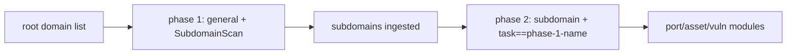

---

## name: scopesentry-mcp
description: Manage the ScopeSentry security-scanning platform via MCP (projects, tasks, templates, assets, nodes). Use when the user mentions ScopeSentry, MCP, API Key, scan tasks, or asset queries.

# ScopeSentry MCP Guide

For users with an **already-deployed ScopeSentry instance**. Connect to the platform through Cursor (or another MCP client) — no local source code needed.

## 1. Setup

### 1.1 Confirm the service is reachable

- Default web UI: `http://<host>`
- MCP endpoint: `http://<host>/mcp` (if a reverse proxy or frontend proxy sits in front, use the actual `/mcp` address)

### 1.2 Create an API Key

1. Log in to the ScopeSentry web UI in a browser
2. Go to the **API Key** management page and create a key (or use an admin-provided endpoint)
3. Save the returned `ssk_...` string (**shown only once**)

### 1.3 Configure Cursor MCP

Cursor → Settings → MCP → add a server:

```json
{
  "mcpServers": {
    "scopesentry": {
      "url": "http://<your-host>:8082/mcp",
      "headers": {
        "X-API-Key": "ssk_your_key"
      }
    }
  }
}
```

Alternative: `Authorization: Bearer ssk_your_key`

After configuring, restart MCP or reload Cursor and confirm tools like `list_projects` and `list_assets` appear in the tool list.

---

## 2. Tool reference


| Tool                     | Purpose                |
| ---------------------- | ----------------- |
| `list_projects`        | Project tree grouped by tag (includes project IDs) |
| `list_projects_data`   | Paginated project list, searchable by name     |
| `get_project`          | Project detail              |
| `create_project`       | Create a project              |
| `list_tasks`           | Scan-task list            |
| `get_task`             | Task detail              |
| `list_scan_templates`  | Scan-template list            |
| `get_scan_template`    | Template detail              |
| `list_plugin_modules`  | Scan-pipeline module names          |
| `list_plugins`         | Available plugins (with hash and default params) |
| `create_scan_template` | Create a scan template            |
| `create_scan_task`     | Create a scan task            |
| `list_assets`          | Query assets of all kinds (paginated)       |
| `count_assets`         | Asset counts (`/api/assets/common/total`) |
| `get_asset_detail`     | Asset or vulnerability detail           |
| `add_asset_tag`        | Add a tag to an asset           |
| `list_nodes`           | Scan-node list            |


Each tool's parameters are defined by its MCP tool description (schema); `list_assets` / `count_assets` share the same search and filter syntax — read the `list_assets` description before querying.

Use `count_assets` (the Web pagination-total endpoint) when you need "how many total" — don't page through `list_assets` just to count.

---

## 3. Common workflows

### 3.1 Query assets by project

When the user or context **already implies a project**, pass `filter.project` to narrow the scope — cross-project data slows responses. Without a clear project, don't force a project filter.

1. `list_projects` or `list_projects_data` → the target project's **ObjectID** (`id` / `children[].value`)
2. `list_assets` with `filter.project` (**must be the ID — not the project's display name**)

```json
{
  "asset_type": "asset",
  "pageIndex": 1,
  "pageSize": 20,
  "search": "domain=^example.com",
  "filter": {
    "project": ["<projectObjectID>"]
  }
}
```

### 3.2 Create a scan task

1. `list_nodes` → names of online nodes
2. `list_scan_templates` or `create_scan_template` → template **ObjectID**
3. `create_scan_task`: `name` and `node` required; `template` takes the template ID (not its name)

**Target source `targetSource` (same as the Web UI):**

| targetSource | Meaning | Required params |
| --- | --- | --- |
| `general` | Type targets directly | `target` |
| `project` | Read targets from a project | `project` (array of project ObjectIDs) |
| `asset` | Search the Web asset store | `search`; optional `project`, `filter`, `targetNumber` |
| `RootDomain` | Search the root-domain store | `search`; optional `project`, `filter`, `targetNumber` |
| `subdomain` | Search the subdomain store | `search`; optional `project`, `filter`, `targetNumber` |
| `UrlScan` | Search URL-scan results | `search`; optional `project`, `filter`, `targetNumber` |
| `*Source` (e.g. `subdomainSource`) | Create from an asset page's "selected/searched" | `targetTp=search` → use `search`; `targetTp=select` → use `targetIds` |

**Example — scan root domains directly:**

```json
{
  "name": "example-subdomain-collection",
  "node": ["node-1"],
  "template": "<templateObjectID>",
  "targetSource": "general",
  "target": "example.com\nfoo.com",
  "project": ["<projectObjectID>"]
}
```

**Example — continue scanning from the subdomain store (filter by previous task name):**

```json
{
  "name": "example-ports-and-vulns",
  "node": ["node-1"],
  "template": "<followupModuleTemplateObjectID>",
  "targetSource": "subdomain",
  "search": "task==\"example-subdomain-collection\"",
  "project": ["<projectObjectID>"]
}
```

### 3.3 Full collection for root domains (two phases recommended)

When the input is a **root domain** and you want **complete information gathering**, split into two scans — don't run the whole pipeline in one pass.

**Why:** distributed tasks dispatch per **single target**. With a root domain as the target, whichever node receives it also runs follow-up modules on the subdomains discovered there — uneven load, slower, more error-prone.

**Best practice:**

1. **Phase one — subdomain collection only**
   - `targetSource`: `general`
   - `target`: all root domains (one per line)
   - Template: enable only `SubdomainScan`, `SubdomainSecurity` (subdomain scan + takeover check)
   - Poll with `get_task` until done

2. **Phase two — follow-up modules**
   - `targetSource`: `subdomain`
   - `search`: `task=="<phase-one task name>"` (exact match)
   - Optional `project` to narrow scope
   - Template: port scan, asset mapping, vulnerability scan, etc. (SubdomainScan optional)
   - Subdomains dispatch to nodes as individual targets — better parallelism

Same effect in the Web UI: filter the "subdomain" asset page by task name, then "create task from subdomains".



### 3.4 Create a scan template

1. `list_plugin_modules` → module-name list
2. `list_plugins` (filterable by `module`) → each plugin's `hash` and default `parameter`
3. `create_scan_template`: `modules` maps "module → array of plugin hashes"

---

## 4. Asset queries (`list_assets` / `count_assets`)

`count_assets` takes the same `asset_type`, `search`, `filter` as `list_assets` and returns `{ "total": N }` — the Web `/api/assets/common/total` endpoint.

```json
{
  "asset_type": "subdomain",
  "search": "task==\"some-task-name\"",
  "filter": {"project": ["<projectObjectID>"]}
}
```

**Performance advice (applies to `list_assets` / `count_assets`):** prefer `filter.project` when a project is in scope; in `search`, use `==` (exact) or `^`-prefixed matching on indexed fields (see [4.3](#43-search-search-expressions)) — broad `=` fuzzy queries get slow. Don't force a project filter when there's no project context.

Asset types supporting `filter.project` are in the [4.4](#44-filter-exact-filtering) table.

### 4.1 Asset types `asset_type`

`asset`, `RootDomain`, `subdomain`, `app`, `mp`, `UrlScan`, `SensitiveResult`, `DirScanResult`, `crawler`, `vulnerability`, `PageMonitoring`, `IPAsset`, `SubdomainTakerResult`

Alias examples: `web`→asset, `vuln`→vulnerability, `ip`→IPAsset, `url`→UrlScan

### 4.2 Parameter reference


| Param                       | Description                                      |
| ------------------------ | --------------------------------------- |
| `pageIndex` / `pageSize` | pagination, default 1 / 20                            |
| `search`                 | search expression (next section)                              |
| `filter`                 | exact-filter JSON (next section)                          |
| `sort`                   | only UrlScan, DirScanResult — sortable by `length` |
| `sid`                    | SensitiveResult only: sensitive-rule name                |


`search` and `filter` **can be combined**.

### 4.3 search expressions

Custom DSL (**not SQL**):


| Operator  | Meaning   | Index | Example                          |
| ---- | ---- | ---- | --------------------------- |
| `=`  | fuzzy match (regex) | not indexed | `domain=example`            |
| `==` | exact match | **indexed** | `port==443`                 |
| `!=` | exclusion   | — | `port!="80"`                |
| `&&` | AND    | — | `domain==example.com && port==443` |
| `||` | OR    | — | `title=admin \|\| body=login` |


**Indexing:** fields like `domain`, `ip`, `port`, `title` are indexed — but only **`==` exact** or **values starting with `^` (prefix match, e.g. `domain=^example.com`)** use the index; **`=` becomes a regex fuzzy match and can't use it** — slow on large datasets.

**search fields common to all types:** `tag`, `task` (task name), `rootDomain`

**`project` cannot appear in `search`** (no-op or errors when combined with `&&`). Filter projects via `filter.project`.

**Common search fields per type:**


| asset_type           | Fields                                                                                  |
| -------------------- | ----------------------------------------------------------------------------------- |
| asset                | domain, ip, port, service, app, title, statuscode, icon, banner, type, body, header |
| RootDomain           | domain, icp, company                                                                |
| subdomain            | domain, ip, type, value                                                             |
| app                  | name, icp, company, category, description, url, apk                                 |
| mp                   | name, icp, company, category, description, url                                      |
| UrlScan              | url, input, source, resultId, type                                                  |
| SensitiveResult      | url, sname, body, info, md5                                                         |
| DirScanResult        | url, statuscode, redirect, length                                                   |
| vulnerability        | url, vulname, matched, request, response, level                                     |
| crawler              | url, method, body, resultId                                                         |
| PageMonitoring       | url, hash, diff, response                                                           |
| IPAsset              | ip, domain, port, service, webServer, app                                           |
| SubdomainTakerResult | domain, value, type, response                                                       |


**search examples:**

- `domain==www.example.com && port==443` (exact, indexed)
- `domain=^example.com` (prefix match, indexed)
- `ip==192.168.1.1`
- `task=="some-task-name"`
- `level==high` (vulnerability)
- `statuscode==200` (DirScanResult)

Use `=` only when fuzzy containment is needed, e.g. `title=admin` (not indexed — narrow the scope with a project or other conditions).

### 4.4 filter — exact filtering

JSON object: multiple values under the same key are **OR**; different keys are **AND**.

**Prefer `project` when a project is known:** if the user/context names a project and the asset_type supports `project`, include it to narrow scope; not mandatory without project context.


| filter key   | Meaning       | Value notes                                                     |
| ------------ | -------- | -------------------------------------------------------- |
| `project`    | owning project     | **ObjectID** — from `list_projects` / `list_projects_data` |
| `task`       | source task     | **task name** — `name` from `list_tasks`                         |
| `port`       | port       | e.g. `"443"`                                                |
| `service`    | service/protocol    | e.g. `"https"`                                              |
| `app`        | app fingerprint     | e.g. `"Nginx"`                                              |
| `icon`       | icon hash  |                                                          |
| `statuscode` | HTTP status code | mainly for asset                                               |
| `status`     | status       | UrlScan/DirScan HTTP code; vuln/sensitive-info handling status                       |
| `level`      | severity     | critical / high / medium / low / info                    |
| `type`       | type       | e.g. subdomain record types A, CNAME                                         |
| `color`      | sensitive-rule color   | SensitiveResult                                          |
| `sname`      | sensitive-rule name    | SensitiveResult                                          |
| `tags`       | tags       |                                                          |


**Available filter keys per type:**


| asset_type                            | filter keys                                                      |
| ------------------------------------- | --------------------------------------------------------------- |
| asset                                 | project, port, service, app, icon, statuscode, type, task, tags |
| RootDomain                            | project, tags                                                   |
| subdomain                             | project, type, task, tags                                       |
| app / mp                              | project, tags                                                   |
| UrlScan                               | status, tags                                                    |
| DirScanResult                         | status, tags                                                    |
| SensitiveResult                       | status, color, sname, tags                                      |
| crawler                               | project, task, tags                                             |
| vulnerability                         | project, level, status, task, tags                              |
| PageMonitoring / SubdomainTakerResult | tags                                                            |
| IPAsset                               | project, port, service, app                                     |


**filter example:**

```json
{"project": ["<projectObjectID>"], "port": ["443"]}
```

**Combined-query example:**

```json
{
  "asset_type": "asset",
  "search": "domain=^baidu && port==443",
  "filter": {"project": ["<projectObjectID>"]},
  "pageIndex": 1,
  "pageSize": 10
}
```

**Notes:**

- Prefer `filter.project` (when supported) with a known project; optional otherwise
- Never put the project's display name in `filter.project`
- `==` for known values, `^` for prefixes; avoid abusing `=` fuzzy matching on large tables
- UrlScan HTTP status uses `filter.status`; DirScanResult can use `statuscode==200` in search
- SensitiveResult by rule name: `search` with `sname=<rule name>`, or `filter.sname`

### 4.5 Sorting

Only **UrlScan** and **DirScanResult** support it:

```json
{"length": "ascending"}
```

Other types ignore `sort` and default to time ordering.

---

## 5. Scan-template module names

`TargetHandler`, `SubdomainScan`, `SubdomainSecurity`, `PortScanPreparation`, `PortScan`, `PortFingerprint`, `AssetMapping`, `AssetHandle`, `URLScan`, `WebCrawler`, `URLSecurity`, `DirScan`, `VulnerabilityScan`, `PassiveScan`

---

## 6. Troubleshooting


| Symptom        | Fix                                                 |
| --------- | -------------------------------------------------- |
| No MCP tools   | Check the URL, API Key, and that ScopeSentry is running                    |
| 401 / 403 | Re-create or rotate the API Key                                    |
| Assets not found     | Confirm `filter.project` holds an ObjectID; never put `project` in `search` |
| Template/task creation fails | `template` must be the template ObjectID; `node` takes an online node name            |
| Queries slow/hanging   | With a project, add `filter.project`; switch `search` to `==` or `^` prefix on indexed fields, avoid `=`; shrink `pageSize` |


---
